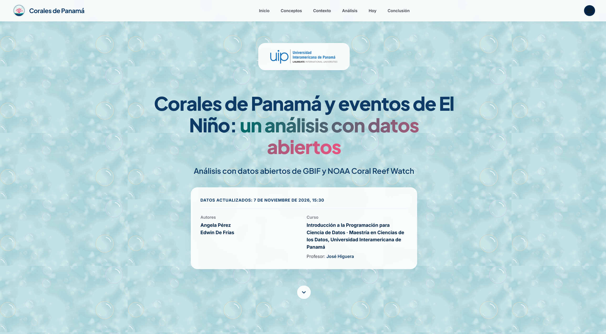

# Corales de Panamá y eventos de El Niño: un análisis con datos abiertos

**Integrantes:** Angela Pérez ([@gigideuva](https://github.com/gigideuva)) · Edwin De Frías ([@edwin-defrias](https://github.com/edwin-defrias))

**Curso:** Introducción a la Programación para Ciencia de Datos · Maestría en Ciencias de los Datos, Universidad Interamericana de Panamá

**Profesor:** José Higuera

[](https://gigideuva.github.io/CORALES_TEMPERATURA_MAR/dashboard/)

**Ver el dashboard en línea:** [gigideuva.github.io/CORALES_TEMPERATURA_MAR/dashboard](https://gigideuva.github.io/CORALES_TEMPERATURA_MAR/dashboard/)


## Pregunta de investigación

¿Cómo ha cambiado el estrés térmico en el Caribe y el Pacífico de Panamá desde 1985, y qué tan expuestos están los corales registrados en cada costa a un riesgo potencial de blanqueamiento?

## Estructura de la carpeta

```
CORALES_TEMPERATURA_MAR/
├── .github/workflows/
│   └── actualizar.yml           actualización diaria automática (GitHub Actions)
├── README.md                    este archivo
├── requirements.txt             bibliotecas necesarias
├── ejecutar_todo.py             ejecuta todo el flujo en orden (pasos 1 a 4)
├── actualizar.bat               ejecuta todo y guarda un registro de mensajes
├── descargar_temperatura.py     paso 1: descarga los datos de NOAA
├── generar_dashboard.py         paso 4: genera el dashboard
├── descargar_contorno.py        se usa una sola vez: contorno de Panamá para el mapa
├── ver_ultimos_dias.py          consulta rápida de los últimos 3 días de temperatura
├── contenido.md                 textos del dashboard
├── imagenes/                    logos, fondos y fotos del dashboard
├── datos/
│   ├── originales/              datos crudos, sin modificar (GBIF, NOAA, contorno)
│   └── limpios/                 datos limpios y tablas para el dashboard
├── notebooks/
│   ├── 1_limpieza_corales.ipynb
│   ├── 2_limpieza_temperatura.ipynb   paso 2
│   └── 3_analisis.ipynb               paso 3
└── dashboard/
    └── index.html               el reporte final (se abre con doble clic)
```

## Cómo ejecutar

**1. Instalar las bibliotecas** (una sola vez), desde la carpeta del proyecto:

```
py -3.14 -m pip install -r requirements.txt
```

**2. Descargar el contorno de Panamá** (una sola vez, para el mapa del dashboard):

```
py -3.14 descargar_contorno.py
```

**3. Actualizar todo:**

```
py -3.14 ejecutar_todo.py
```

Este script ejecuta en orden:

1. `descargar_temperatura.py`: descarga los datos más recientes de las 4 estaciones de NOAA. Si una descarga falla, la intenta 3 veces; si no lo logra, conserva el archivo anterior.
2. `notebooks/2_limpieza_temperatura.ipynb`: limpia la temperatura y guarda `temperatura_limpio.csv`.
3. `notebooks/3_analisis.ipynb`: recalcula el análisis y guarda las tablas del dashboard.
4. `generar_dashboard.py`: genera `dashboard/index.html` con los datos nuevos.

**4. Ver el reporte:** abrir `dashboard/index.html` con doble clic. Funciona sin internet.

## Actualización automática

El repositorio se actualiza solo todos los días a las 10:00 a. m. (hora de Panamá) con **GitHub Actions** (archivo `.github/workflows/actualizar.yml`). GitHub ejecuta `ejecutar_todo.py` en la nube y, si hay cambios, guarda los datos, los notebooks y el dashboard con un commit de `github-actions[bot]`. También se puede ejecutar a mano desde la pestaña **Actions** → **Run workflow**.

Para actualizar desde una computadora con Windows, se puede ejecutar `actualizar.bat`, que corre `ejecutar_todo.py` y guarda los mensajes en `registro_actualizacion.txt`.

NOAA publica los datos con 1 a 2 días de retraso, por lo que el último dato suele ser de ayer o anteayer.

Los datos de corales (GBIF) son una descarga fija y no cambian; por eso `1_limpieza_corales.ipynb` no forma parte de la actualización diaria.

## Fuentes de datos

- **Corales:** GBIF.org (22 de octubre de 2026), GBIF Occurrence Download, https://doi.org/10.15468/dl.uk243b
- **Temperatura:** NOAA Coral Reef Watch, 5 km Regional Virtual Stations v3.1 (estaciones Panama Atlantic East, Atlantic West, Pacific East y Pacific West).
- **Contorno de Panamá:** geoBoundaries (gbOpen, ADM0), dominio público.
